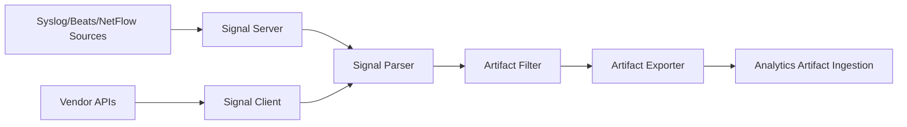

# Conductor

Conductor is WitFoo's signal pipeline for collecting, parsing, and exporting security logs to WitFoo Analytics.

## Architecture



## Services

| Service | Port | Description |
| --- | --- | --- |
| **Signal Server** | 514/udp, 514/tcp, 5044, 5045, 6514, 7514, 2055/udp | Receives syslog, Beats and NetFlow/IPFIX input |
| **Signal Client** | Internal | Polls vendor APIs (pull connectors) |
| **Signal Parser** | Internal | Parses raw signals into structured data |
| **Artifact Filter** | Internal | Filters and normalizes artifacts |
| **Artifact Exporter** | Internal | Sends artifacts to Analytics via HMAC-authenticated HTTP |
| **Broker** | 4223 | NATS JetStream for inter-service messaging |

On a WFA appliance running WFA 2.5.1 or later:

- The broker (4223) is published on `127.0.0.1` only.
- 2055/udp is published on Conductor and AIO + Conductor nodes and opened in the host firewall. The NetFlow/IPFIX listener stays off until you enable it under **Log Servers** in the Conductor UI. See [Log Server Configuration](../conductor/ui/log-servers.md).

The Conductor sends artifacts to the Analytics receiver at `https://<analytics-host>:8443/v1/conductor/artifacts/batch`, or the internal port 8090 on an AIO + Conductor appliance. See [Conductor API](../api/endpoints/conductor.md).

## HMAC Authentication

The Artifact Exporter authenticates with Analytics using HMAC-SHA256:

1. Body hash: `hex(SHA256(body))`
2. Message: `timestamp + "." + bodyHash`
3. Signature: `hex(HMAC-SHA256(secret, message))`

Configured via `ANALYTICS_SECRET` on both Conductor and Analytics.

## Management

### Start/Stop

A Conductor appliance is managed with the WFA CLI:

```bash
sudo wfa start
sudo wfa stop
sudo wfa restart
sudo wfa status
```

See [WFA CLI Reference](../conductor/wfa-cli.md).

### Conductor UI

Access the Conductor UI through the Analytics reverse proxy. Requires `conductor:read` permission. The UI uses JWT auth bridge — Analytics JWT tokens are validated and mapped to Conductor roles.

On a standalone Conductor node, the Conductor UI serves its own sign-in page. From 1.2.0, its SAML sign-in signs in only accounts whose Auth Source is SAML (SSO). See [User Management & Authentication](../conductor/ui/users.md).

### Upgrading

Upgrade every Conductor, including separate or remote Conductor nodes, at the same time as Analytics or before it. A Conductor on 1.1.5 or older sending to 1.2.0 Analytics keeps only about one record per page or poll for several pull connectors. See [Upgrading to 1.2.0](../reference/upgrade-1.2.0.md).

## Permissions

| Permission | Access Level |
| --- | --- |
| `conductor:read` | View Conductor UI |
| `conductor:write` | Configure Conductor |
| `conductor:admin` | Full Conductor administration |
