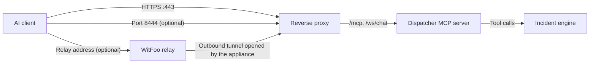

# MCP Architecture

The MCP server runs in the analytics dispatcher, behind the appliance's reverse proxy, and checks every request against the connected user's live permissions.

## Components

| Component | Container | Role |
| --- | --- | --- |
| Reverse proxy | `analytics-reverse-proxy-svc` | Receives client connections on `:443` (and on the optional exposure listener and relay tunnel), refuses keys sent in a URL, and forwards MCP traffic to the dispatcher |
| Dispatcher | `analytics-dispatcher-svc` | Serves `POST /mcp` and `/ws/chat`, authenticates the credential, admits the request and authorizes each tool call |
| Incident engine | — | Answers most tool calls. It checks its own route permission for each call. |
| API | — | Hosts the self-service key routes, the administrator routes and the app sign-in endpoints |

## How a request reaches the MCP server



- **The main listener (`:443`)** serves the UI, the API and the WebSockets as well as `/mcp`.
- **The [exposure listener](exposure-listener.md)** on port 8444 is optional. It serves `/mcp` and the app sign-in endpoints and nothing else.
- **The [AI-connector relay](relay.md)** is optional. The appliance opens one outbound connection to WitFoo's relay, and requests to the relay address travel down it to the reverse proxy.

Every route applies the same authentication, admission and authorization.

## The three checks on every request

```text
door (per connection or HTTP request)  →  admission (per request)  →  authorization (per tool call)
```

### Door

The door reads the credential and identifies the user:

- **Personal key:** the key's own record, its owner and its expiry.
- **Browser session:** the session token.
- **App access token:** its signed claims (user, organization, app, grant, scope, and when it was issued and expires). The check is by computation alone and reads no storage.

### Admission

Admission re-reads, with no cache, everything that can revoke access:

1. The credential's own record. A key must be present, not revoked, not expired, with the same owner. An access token's grant must be present and not revoked, and the app must still be allowed.
2. The organization's MCP mode: personal keys need **Browser chat sessions and personal keys** or **Browser chat sessions, personal keys and app sign-in**. Access tokens need app sign-in. Browser sessions work in every mode.
3. The tenant is not suspended or deleted.
4. The user exists, is active and belongs to the credential's organization.
5. The credential was issued after the user's last password reset or deactivation.
6. The user's roles, resolved in their home organization.
7. The user holds `mcp:connect`.
8. The appliance licence includes the MCP connector, or no licence has been learned yet. See [MCP Licensing](licensing.md).

Admission runs on every request except `ping` and `notifications/*` on an open WebSocket. It runs for `tools/list` too. A transient database error denies that one request and does not close the connection.

### Authorization

Authorization checks the permission the tool needs, or, for the eight `manage_*` tools, the permission of the requested `action`, against the permissions admission just resolved. Anything ambiguous is denied. For an app approved with read access only (`mcp:read`), the user's permissions are narrowed to their `:read` permissions. See [Tools](tools.md) for the permission each tool needs.

When a tool calls the incident engine, the dispatcher sends a short-lived token that carries only the one permission it just checked, and the incident engine checks it again where its route carries a permission.

## The HTTP transport is stateless

`POST /mcp` holds no session between requests. It issues no `Mcp-Session-Id` header, and `GET /mcp` answers `405`. Each request is authenticated and admitted on its own, so a change to a key, a grant, a user, a role or the organization's mode applies to the next request.

## The in-app assistant

The product's own chat assistant does not use `/ws/chat`. It calls tools through a bridge in the API, and each tool call is authorized against the caller's own permissions by the same decision as an MCP `tools/call`. Reading chat sessions needs `ai:read`, and sending a message needs `ai:write`. See [Tools](tools.md).

## Upgrade order

!!! warning "Upgrade the incident engine and the dispatcher together"
    Upgrade the incident engine and the dispatcher together, or the incident engine first. While they run different versions, most MCP tool calls can fail with an `unexpected status 401` error. See [Upgrading to 1.2.0](../../reference/upgrade-1.2.0.md).
