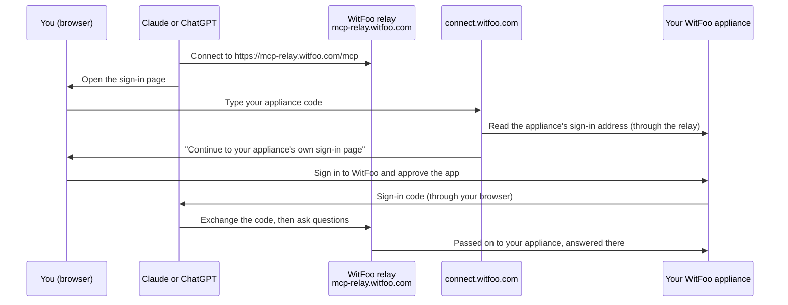

# Connect WitFoo to ChatGPT and Claude

Ask Claude or ChatGPT about your security environment and get answers built from your WitFoo appliance:
open work units, what an attacker touched, your compliance posture, what your tools are catching. The AI
app connects to WitFoo's **MCP server** (Model Context Protocol, the open standard these apps use to call
outside tools). Every question runs **as you**, with your WitFoo permissions, and your security data stays
on your appliance until a question asks for it.

There are two ways to connect:

| | Single connector address | Your appliance's own address |
| --- | --- | --- |
| Address the app uses | `https://mcp-relay.witfoo.com/mcp`, the same for every WitFoo customer | Your appliance's address, for example `https://mcp.example.com/mcp` |
| How you pick your appliance | You type your **appliance code** at **connect.witfoo.com** | The address is your appliance |
| Needs | **analytics 1.2.1** and **WFA 2.5.5** on the appliance, and the relay turned on | **analytics 1.2.0** or later, MCP turned on, and an address the AI app's servers can reach |
| Passes through WitFoo's relay | Yes | No |

This page takes an administrator and a user through the single address:

1. [Check the prerequisites](#prerequisites).
2. [Make sure Conductor ingests your data sources](#make-sure-conductor-ingests-your-data-sources).
3. [Turn on the relay on the appliance](#turn-on-the-relay-on-the-appliance) (administrator).
4. [Allow app sign-in for your organization](#allow-app-sign-in-for-your-organization) (administrator).
5. [Add WitFoo in Claude or ChatGPT and sign in](#add-witfoo-in-claude-or-chatgpt) (each user).

To connect at your appliance's own address instead, see [Connect at your appliance's own address](#connect-at-your-appliances-own-address).

!!! info "Requires analytics 1.2.1 or later"
    The single connector address, `https://mcp-relay.witfoo.com/mcp`, with sign-in at **connect.witfoo.com**,
    works only with **analytics 1.2.1** or later and **WFA 2.5.5** or later on the appliance. An appliance on
    analytics 1.2.0 can connect apps only at its own address or at its per-appliance relay address (see
    [Other ways to connect](#other-ways-to-connect)).

## How it works



- **One address for everyone.** Every WitFoo customer adds the same address. You tell WitFoo which
  appliance is yours by typing your **appliance code** on the sign-in page.
- **No inbound port.** Your appliance keeps one outbound connection open to WitFoo's relay. The AI app's
  requests travel down that connection, and the answers come back up it.
- **Your appliance is the only place you sign in.** connect.witfoo.com never asks for your WitFoo
  username or password. It sends you to your appliance's own sign-in and approval page, which does not
  pass through WitFoo.
- **The relay keeps no sign-in request or token.** It writes no sign-in request, token or network
  address to its database or logs. Its logs do record that each request to the sign-in page happened
  (path, time, status, sizes, duration and outcome, and your appliance's code once the code you typed
  names an appliance whose relay is on), and keep those lines for 30 days. See [Privacy](#privacy).

## Prerequisites

| What | Requirement |
| ---- | ----------- |
| Licence | **Analytics Pro, Analytics Max or Reporter Pro.** Other licences refuse MCP connections with `feature_not_available`. See [MCP Licensing](licensing.md). |
| Appliance software | **analytics 1.2.1** or later and **WFA 2.5.5** or later. |
| Network, appliance | One outbound HTTPS connection to `mcp-relay.witfoo.com` on port 443. No inbound port. An HTTP proxy is not used. The appliance must also fetch each app's published client metadata document over HTTPS, directly (no forward proxy), so it needs outbound access to the app's metadata host. |
| Network, users | Each user's **browser** must reach the appliance's web UI, because the approval page is not relayed. Users off-site need whatever access (for example VPN) they normally use to reach WitFoo. |
| Appliance sign-in page | An `https` address for the appliance's web UI that users' browsers can reach (`mcp_oauth_ui_url`). |
| WitFoo account | Each user needs the **Connect MCP** permission (`mcp:connect`). Admin and Platform Admin have it; anyone else needs a custom role that includes it. The answers each user gets are limited to what their own role can see. |
| AI app | A Claude or ChatGPT plan that lets you add a custom connector or MCP server. On some business plans only a workspace administrator can add or allow one. |

!!! warning "Air-gapped or privacy-sensitive deployments"
    The relay is off by default. An air-gapped or privacy-sensitive deployment should leave it off. Read
    [Privacy](#privacy) before you turn it on.

## Make sure Conductor ingests your data sources

An AI app can only answer from what WitFoo has seen. Before you connect one, make sure the
[Conductor](../../conductor/index.md) is collecting from the systems you want to ask about: firewalls,
endpoint tools, identity providers, cloud accounts, email security and the rest.

- **Push sources** (syslog, Beats and similar) send to the Conductor's listeners:
  see [Signal Server](../../conductor/signal-server.md) and the [Parser Catalog](../../conductor/parsers-catalog.md).
- **Pull sources** (vendor APIs) are collected by Conductor integrations: see the
  [Integration Guides](../../conductor/integrations/index.md).
- The [Integration Catalog](../../reference/integration-catalog.md) lists every parser, pull connector,
  exporter and processor in the current release.
- **NetFlow and IPFIX** go to UDP port 2055 (published by WFA 2.5.1 and later (install WFA 2.5.5, the current release); the collector needs analytics 1.2.0 or later). The collector is **off
  until you switch it on**: in the Conductor UI, **Admin → Settings → Log Servers**, turn on
  **UDP/2055 (NetFlow / IPFIX)** (see [Log Servers](../../conductor/ui/log-servers.md)).
- Check that data is flowing: **Signals → Search** shows recent artifacts, and the Conductor UI
  [Dashboard](../../conductor/ui/dashboard.md) shows message throughput through each pipeline stage.

### Why it matters for AI answers, and for tokens

AI apps are billed, and limited, by the **token**: every word the model reads costs. A model that is
handed raw logs spends most of its budget reading lines that do not matter, and still has to work out
how they relate.

WitFoo does that work before any model sees the data. The Conductor parses and shapes every signal, and
Analytics builds the graph, scores suspicion, and groups related activity into **work units** with their
evidence, reports and compliance status. What reaches the systems downstream is more than ninety percent
smaller, and every record in it points back to its raw evidence. That is not sampling. Nothing
security-relevant is discarded.

So when you ask Claude or ChatGPT a question, WitFoo's tools answer with that finished record: a work
unit with its suspicion score and linked evidence, a compliance status, an executive summary. The model
reads a short, structured answer instead of thousands of log lines, which keeps each question small and
the answer grounded in your data.

How many tokens a question uses depends on the question, the app and the model. Ask for work units,
summaries and reports first, and use artifact search for a specific follow-up rather than as a starting
point.

## Turn on the relay on the appliance

An administrator does this once per appliance, at the appliance's shell. See also
[AI-Connector Relay](relay.md).

!!! info "Requires analytics 1.2.1 or later"
    The relay itself needs WFA 2.5.1 or later (install WFA 2.5.5, the current release) and analytics 1.2.0 or later. The single address
    (`https://mcp-relay.witfoo.com/mcp`) needs **WFA 2.5.5** and **analytics 1.2.1**.

1. **Turn on the MCP HTTP transport.** In `/witfoo/configs/node.json`, set:

    ```json
    {
      "mcp_http_enabled": true,
      "mcp_oauth_ui_url": "https://analytics.example.com"
    }
    ```

    `mcp_oauth_ui_url` is the `https` address at which your users' browsers reach the WitFoo web UI.
    Then run `wfa restart`.

2. **Turn on the relay.**

    ```bash
    wfa mcp-relay enable
    ```

    It shows WitFoo's relay notice. Read it, then type `ENABLE` (anything else leaves the relay off). The
    command registers the appliance and, when the appliance supports it, sets the single address as the
    sign-in address (`mcp_public_url`). It fills that field only when it is empty: if `mcp_public_url`
    already holds another address, it is left as it is and app sign-in stays at that address. Then run:

    ```bash
    wfa restart
    ```

3. **Note the three lines it prints** (you can show them again at any time with `wfa mcp-relay status`):

    ```text
    Address for Claude, ChatGPT and other apps that sign in: https://mcp-relay.witfoo.com/mcp
    Appliance code (type it when an app asks which appliance): <your appliance code>
    Address for clients that send a personal key: https://mcp-relay.witfoo.com/h/<your appliance code>/mcp
    ```

    The **appliance code** is 26 characters of lower-case letters and the digits 2 to 7. Give it to your
    users: they type it on the sign-in page. It identifies your appliance; it is not a password, and on
    its own it gives no access to WitFoo.

4. **If the first line names your appliance's own relay address instead,** the command says why (for
   example, the appliance runs an analytics version older than 1.2.1). Once the requirement is met, or if you turned
   the relay on before you upgraded, switch with:

    ```bash
    wfa mcp-relay sign-in universal
    wfa restart
    ```

    Apps that were connected at the old address must sign in again after a switch.

**AI Setup → MCP relay** in the WitFoo web UI also shows the sign-in address and the appliance code
(copyable), while the relay is on and the appliance uses the single address (it needs the `mcp:manage`
permission).

## Allow app sign-in for your organization

An administrator does this once per organization, in the WitFoo web UI. Step 1 needs `mcp:manage` (the
AI Setup page also needs `ai:manage`); the client policy in steps 2 and 3 needs the `admin` permission.
See also [App Sign-in (OAuth 2.1)](oauth.md).

1. Open **AI Setup → MCP Authentication** and choose **Browser chat sessions, personal keys and app
   sign-in**, then save. If the page says *App sign-in is not available on this appliance*, the
   appliance's sign-in address or `mcp_oauth_ui_url` is not set to a valid value: check the previous
   section.
2. Open **AI Setup → MCP Authentication → Client policy**. The default mode, `allowlist`, admits **no**
   app until you add it.
    - **Claude:** use **Add to the allow list** and choose **Claude**
      (`https://claude.ai/oauth/mcp-oauth-client-metadata`).
    - **ChatGPT:** add the host entry `chatgpt.com`. ChatGPT's client document address varies, and a host
      entry admits every document at that host.
3. Still in **Client policy**, check **most access**. It is **read-only** by default, which means an app
   can read but never make changes, whatever a user approves. Raise it only if you want users to be able
   to let an app make changes. Then choose **Save policy**.

!!! note "Client metadata documents must be on"
    The single address only works for apps that identify themselves with a published client metadata
    document (CIMD). This is on by default (`mcp_oauth_cimd`). If your appliance has it off, apps sign in
    as registered clients at the per-appliance address instead
    ([Other ways to connect](#other-ways-to-connect)).

## Add WitFoo in Claude or ChatGPT

Each user does this once in each app. You need the **appliance code** from your administrator.

!!! info "WitFoo in the app directories"
    WitFoo is listed in Claude's connector directory:
    [claude.ai/directory/witfoo](https://claude.ai/directory/witfoo). The listing uses the single connector
    address, so it needs **analytics 1.2.1** or later and **WFA 2.5.5** or later on the appliance, with the
    relay and app sign-in set up as above. On analytics 1.2.0, add WitFoo in Claude as a custom connector at
    your appliance's own address instead (see
    [Connect at your appliance's own address](#connect-at-your-appliances-own-address)).

    WitFoo is not listed in the ChatGPT app directory. In ChatGPT, add WitFoo as a custom connector, as
    below.

The apps change their menu names from time to time. The steps below are as of November 2026.

=== "Claude"

    To add WitFoo from Claude's directory instead of as a custom connector, open the
    [WitFoo listing](https://claude.ai/directory/witfoo), connect it, and continue at step 3.

    1. In Claude, open **Customize → Connectors** and choose **Add custom connector**.
    2. Name it `WitFoo`, enter `https://mcp-relay.witfoo.com/mcp`, and choose **Connect**.
    3. A browser window opens at **connect.witfoo.com**. Follow
       [Sign in through connect.witfoo.com](#sign-in-through-connectwitfoocom).
    4. Back in Claude, WitFoo shows as connected. In a chat, make sure WitFoo is switched on in the
       tools menu.

=== "ChatGPT"

    You do not need developer mode.

    1. In ChatGPT on the web (chatgpt.com), open **Plugins**.
    2. Choose the **+** button, then **Add custom MCP server**.
    3. Name it `WitFoo` and enter `https://mcp-relay.witfoo.com/mcp` as the server URL.
    4. Choose **OAuth** for authentication, with a client metadata document (CIMD) rather than static
       credentials. Read the risk warning, choose **I understand and want to continue**, then
       **Create as a plugin**.
    5. When ChatGPT opens **connect.witfoo.com**, follow
       [Sign in through connect.witfoo.com](#sign-in-through-connectwitfoocom).
    6. Install the plugin. In a chat, type **@** and choose WitFoo.

    On a ChatGPT business plan, a workspace administrator may need to allow WitFoo before members can
    connect it. These steps follow OpenAI's documentation as of November 2026; if your plan's menus differ,
    tell WitFoo support.

### Sign in through connect.witfoo.com

1. **Enter your appliance code.** The page, **Connect your WitFoo appliance**, says *An app at* <app
   host> *asks to connect to your WitFoo appliance*. Check that the app host is the app you are
   connecting (for example, Claude's or ChatGPT's own domain), type your appliance code, and choose
   **Continue**. You can also paste the per-appliance address, `https://mcp-relay.witfoo.com/h/<code>/mcp`.
2. **Check the address on the next page.** It shows your appliance's own sign-in address in large
   text: *Your appliance's own sign-in page is at* <address>. **Continue only if this is your
   organisation's WitFoo appliance**, the same address you use to reach WitFoo. If it is not, do not
   continue: use **Report this address** and tell your administrator.
3. Choose **Continue to** <your appliance>. Your browser opens your appliance's approval page.

### The approval page, on your appliance

This page is part of your WitFoo web UI, titled **Connect an app to WitFoo**. Sign in to WitFoo if it
asks (it asks when your last sign-in is more than 15 minutes old). It shows:

- who you are signed in as, and your organization;
- **the app asking to connect**: its name (declared by the app itself) and its address;
- where the approval is delivered (the app's return address), with a warning if that is on your own
  computer or on a shared hosting service;
- *This app will be able to read what you can read in WitFoo*;
- an option, **off by default**, *Also let this app make changes for you*, listing the tools that make
  changes. It appears only when the app asked for it and your organization allows it.

Choose **Approve**. Your browser returns to the app, which is now connected. You get an **App connected**
notification in WitFoo saying what the app can do and where to revoke it.

## First questions to try

Start with questions that WitFoo answers from its finished record:

- *"Using WitFoo, what are my open work units with the highest suspicion scores?"*
- *"Summarize work unit* <id> *: what happened, which hosts and accounts are involved, and which
  observations matched."*
- *"Give me the latest WitFoo executive summary."* (It reads the latest stored report, not a period you
  choose.)
- *"What is our compliance readiness for each framework?"*
- *"Which of our security tools are contributing the most detections?"*
- *"What does WitFoo know about the IP address* <address> *?"*
- *"Is my WitFoo appliance healthy right now?"*

Each answer is limited to what your WitFoo role can see. If the app says a tool was refused, your role
does not include that permission: ask your administrator.

## Read and write tools, and permissions

From analytics 1.2.1 the MCP server has 58 tools: 35 that only read, and 23 that make changes (analytics 1.2.0 has 44, of which 28 only read).

- **Read tools** search and read: work units and their evidence, graph nodes, artifacts, dashboards,
  reports, audit findings, chat, observations and system health.
- **Write tools** make changes: update a work unit's status, add a note or a task, create a dashboard,
  run a playbook or a responder job, send a chat message, generate a report, and so on.

Three things decide what an app can do, and the narrowest wins:

1. **Your WitFoo role.** The app acts as you, with your permissions, never more.
2. **What you approved.** An approval is read-only unless you turn on *Also let this app make changes
   for you*.
3. **Your organization's client policy.** Its *most access* setting (read-only by default) caps what
   any app that signs in with a client metadata document can be given.

Every tool states three labels for the AI apps: whether it only reads, whether it can change or remove
existing data, and whether it reaches outside your appliance (running a playbook or a responder job
can). An AI app can use these labels, for example to ask you before it calls a tool that makes a change.

## Limits

- **60 seconds a call through the relay.** The relay waits up to 60 seconds for your appliance to answer
  each request. A tool call that takes longer ends with an error instead of the tool's answer. Most tools
  answer in a few seconds; `generate_report` is the one most likely to come close, so ask for a smaller
  report or a shorter period if it times out. At your appliance's own address the limit is the reverse
  proxy's 120 seconds (see [Connecting AI Clients & Marketplaces](connect-clients.md#long-running-tools-over-http)).
- **Request budget.** Each user and app gets your organization's MCP rate limit (60 requests a minute by
  default), and a call to a tool that makes changes counts as four. An app that goes over it is told to
  wait.

## Revoke or disconnect

- **One app, for yourself:** in WitFoo, **Profile → Security → Connected apps**, revoke the app. This
  ends its access at once. Removing the connector inside Claude or ChatGPT alone does not revoke the
  approval on your appliance, so revoke it in WitFoo as well.
- **Any app, for anyone in the organization (administrator):** **AI Setup → MCP Authentication →
  Connected apps in this organization**.
- **An app for everyone:** add it to the client policy's deny list. Saving a policy that denies an app
  revokes its approvals in the organization. Removing an app from the allow list only stops new
  approvals; to end access it already has, revoke its approvals as above.
- **All apps:** choose an authentication mode without app sign-in under **AI Setup → MCP
  Authentication**. This revokes every app approval in the organization.
- **The relay for this appliance:** at the appliance shell run `wfa mcp-relay off`, type `REVOKE`, then
  `wfa restart`. Revocation is permanent: turning the relay on again gives a new appliance code, and
  every app must be connected again.

## Troubleshooting

| What you see | What to do |
| ------------ | ---------- |
| *That is not an appliance code.* | What you typed is not 26 letters and digits or a relay address. Copy the code from **AI Setup → MCP relay**, or ask your administrator (`wfa mcp-relay status`). |
| *No appliance is registered with that code, or its relay was turned off.* | Check the code with your administrator. A revoked relay gives a new code. |
| *Your appliance is not connected to the relay right now.* | The appliance's connection to the relay is down. The administrator runs `wfa mcp-relay status` and checks that the appliance can reach `mcp-relay.witfoo.com` on port 443. |
| *Your appliance did not answer.* | The appliance is connected but did not answer within ten seconds. Try again; check that the appliance is not overloaded. |
| *This appliance signs apps in at its own relay address.* | The appliance is not set to the single address, or is older than analytics 1.2.1. The administrator runs `wfa mcp-relay sign-in universal` and `wfa restart`, or users connect at the per-appliance address. |
| *Your appliance's sign-in details are not ones this page can use.* | Client metadata documents are off on the appliance, or its web UI address is not an `https` address that can be shown safely (for example, an internationalized `xn--` host name). See [Other ways to connect](#other-ways-to-connect). |
| A plain page reading only `error code: 502` or `error code: 504` | An appliance that did not answer or signs apps in at its own relay address, sign-in details this page cannot use, an answer not in a form this page can use, or a tool call that ran past 60 seconds, shown by Cloudflare's own error page. Try again; if it repeats, the administrator runs `wfa mcp-relay status`. |
| *Your appliance is busy right now*, *Too many requests* or *Too many sign-ins for that appliance* | Wait a minute and try again. |
| The address on the *Continue* page is not your WitFoo | Do not continue. Use **Report this address** and tell your administrator. |
| Your browser cannot open the approval page | Your browser must reach the WitFoo web UI. Connect the way you normally reach WitFoo (for example, VPN) and start again from the app. |
| *Your administrator has not allowed this app to connect* | The administrator adds the app under **AI Setup → MCP Authentication → Client policy**. |
| *This appliance could not fetch the app's metadata document* | The appliance could not reach the app's published document. The administrator checks the appliance's outbound access, or registers the app under **OAuth clients** and connects at the per-appliance address. |
| *Your account cannot connect apps here* | Your role lacks the **Connect MCP** permission, or your account belongs to another organization. |
| *This appliance's license does not include connecting apps* | The licence is not Analytics Pro, Analytics Max or Reporter Pro. |
| *This app asked to make changes, but your organization allows read-only access* | The client policy's *most access* is read-only. Ask your administrator if you need changes. |
| The app says a tool was refused | Your WitFoo role does not hold that tool's permission, or the app was approved read-only. |
| A tool call ends in an error after about a minute | It ran past the relay's 60-second limit. See [Limits](#limits). |
| The app worked, then asks you to sign in again | Your approval was revoked, your sessions were ended, the administrator switched the sign-in address, the app had not refreshed its access for 14 days, or the connection reached its 90-day limit. Sign in again from the app. |
| A personal key is refused at `https://mcp-relay.witfoo.com/mcp` | Personal keys work only at the per-appliance address, `https://mcp-relay.witfoo.com/h/<code>/mcp`. |
| **AI Setup → MCP relay** shows *Status unavailable* | Run `wfa mcp-relay status`. If it says `contested`, another party may hold the relay credential: run `wfa mcp-relay off`, `wfa mcp-relay enable` and `wfa restart`, and rotate your personal keys. |

### Known limitations

- The sign-in page at connect.witfoo.com is in English only.
- Users of every customer who reach the relay from one AI provider's addresses share that address's
  relay limits.
- Anyone with a WitFoo licence can run an appliance, so a code typed by mistake can lead to someone
  else's appliance. Always check the address on the *Continue* page.
- If WitFoo stops the single-address sign-in, apps cannot sign in through it until it is back. An
  administrator can switch the appliance to its own relay address with `wfa mcp-relay sign-in handle`
  and `wfa restart`.

## Other ways to connect

### Connect at your appliance's own address

Any appliance on **analytics 1.2.0** or later with an Analytics Pro, Analytics Max or Reporter Pro licence
and MCP turned on can connect Claude or ChatGPT at its **own** address, with no relay. Claude's and
ChatGPT's servers make the calls, not your computer, so they must be able to reach that address from the
internet: publish it through the [exposure listener](exposure-listener.md) (port 8444) behind a proxy or
load balancer with a certificate for the published name. Nothing passes through WitFoo's relay.

1. Turn MCP on and set the appliance's public MCP address: see [Turning MCP On](configuration.md) and
   [App Sign-in (OAuth 2.1)](oauth.md).
2. Allow app sign-in and add the app to the client policy, as in
   [Allow app sign-in for your organization](#allow-app-sign-in-for-your-organization).
3. Add the connector in Claude or ChatGPT as in
   [Add WitFoo in Claude or ChatGPT](#add-witfoo-in-claude-or-chatgpt), but enter your appliance's
   address (for example `https://mcp.example.com/mcp`). The app goes straight to your appliance's
   sign-in and approval page; there is no connect.witfoo.com step and no appliance code.

See [Connecting AI Clients & Marketplaces](connect-clients.md) for desktop clients, personal keys and
the other routes.

### The per-appliance relay address

Every appliance with the relay on (WFA 2.5.1 or later, install WFA 2.5.5, and analytics 1.2.0 or later) also has its own relay
address, `https://mcp-relay.witfoo.com/h/<appliance code>/mcp`. Apps can sign in there when the
appliance is set to its own relay address, and it is the address for clients that send a **personal MCP
key** (created under **Profile → Security → MCP connections**). A connector shared by a whole team takes
one key: give it the key of a dedicated user who holds only the permissions the connector needs, never
an administrator's. See [AI-Connector Relay](relay.md).

## Privacy

Your security data stays on your appliance. It leaves only as the answer to a question an app asks
on your behalf.

- **What the AI provider sees.** Your questions, and the answers WitFoo's tools return, are processed by
  the app's provider (Anthropic for Claude, OpenAI for ChatGPT) under that provider's own terms and your
  plan's settings.
- **What connect.witfoo.com sees.** The app's sign-in request (including its query), the appliance code
  you type, and the page that names your appliance's sign-in address. It never sees the username or
  password you enter on your appliance. The page runs no script and sets no cookie of its own.
- **What the relay keeps.** Requests and answers pass through WitFoo's relay. It reads each one in memory
  only while it passes it on, and writes none of the content, tokens or keys to its database or logs. It
  writes no sign-in request, token or network address from the sign-in page either. Its logs record each
  request, including each request to the sign-in page: an identifier, the method, the path, the time, the status,
  the sizes, the duration and the outcome, and your appliance's handle once the code you typed names an
  appliance whose relay is on. The logs are kept for 30 days.
- **Cloudflare** serves mcp-relay.witfoo.com and connect.witfoo.com and sees this traffic in transit. Its
  security records can include the sign-in request, and are kept for up to 31 days. If Cloudflare's
  protection decides to check your browser, it shows its own check page first, which runs Cloudflare's
  script and can set Cloudflare's cookie.
- **Off by default.** The relay is off for every organization and every appliance until an administrator
  turns it on and acknowledges WitFoo's relay notice.
- **At your appliance's own address**, nothing passes through WitFoo's relay or connect.witfoo.com.

The full description is in the [WitFoo privacy policy](../../privacy.md#5-the-ai-assistant-connector),
section 5, "The AI-assistant connector", and in [the relay's notice](relay.md#the-notice).

---

*Claude is a trademark of Anthropic, PBC. ChatGPT is a trademark of OpenAI. Other product names are trademarks of their owners, used here only to identify the products. No endorsement or partnership is implied.*
