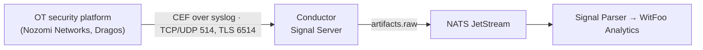

---
tags:
  - conductor
  - integration
  - syslog
---

# Syslog Sources

Some security platforms push their events to WitFoo Conductor as syslog
instead of being polled through an API. They send to the Conductor
[Signal Server](../signal-server.md), which listens for syslog on TCP and UDP
514 and for encrypted syslog on TLS 6514 (see
[Log Server Configuration](../ui/log-servers.md)).

This is different from the [pull-based API integrations](../integrations/index.md),
where the Signal Client polls a vendor API. With a syslog source, the platform
connects to Conductor and pushes events as they happen.

## Guides

| Source | Format | Guide |
|---|---|---|
| Nozomi Networks (Guardian, CMC) | CEF over syslog | [Set up →](nozomi-networks.md) |
| Dragos Platform | CEF over syslog | [Set up →](dragos.md) |

!!! tip "Prefer TCP or TLS"
    UDP syslog can drop messages under load because it has no delivery
    guarantee. Use TCP 514 or TLS 6514 for alerts you need to keep.

---

*See also: [Signal Server](../signal-server.md) ·
[Log Server Configuration](../ui/log-servers.md) ·
[Parser Catalog](../parsers-catalog.md) ·
[Common Troubleshooting](../integrations/common-troubleshooting.md)*
