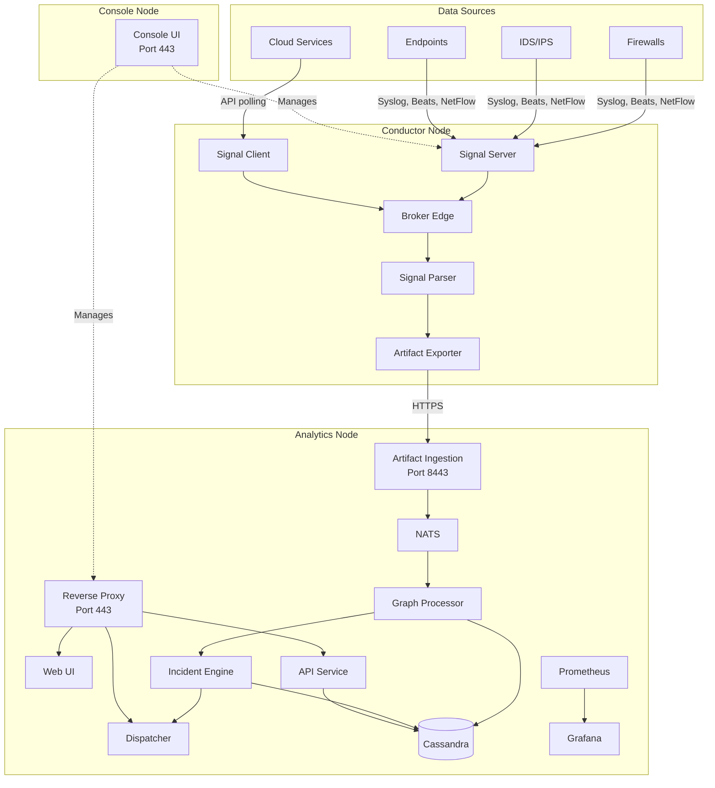
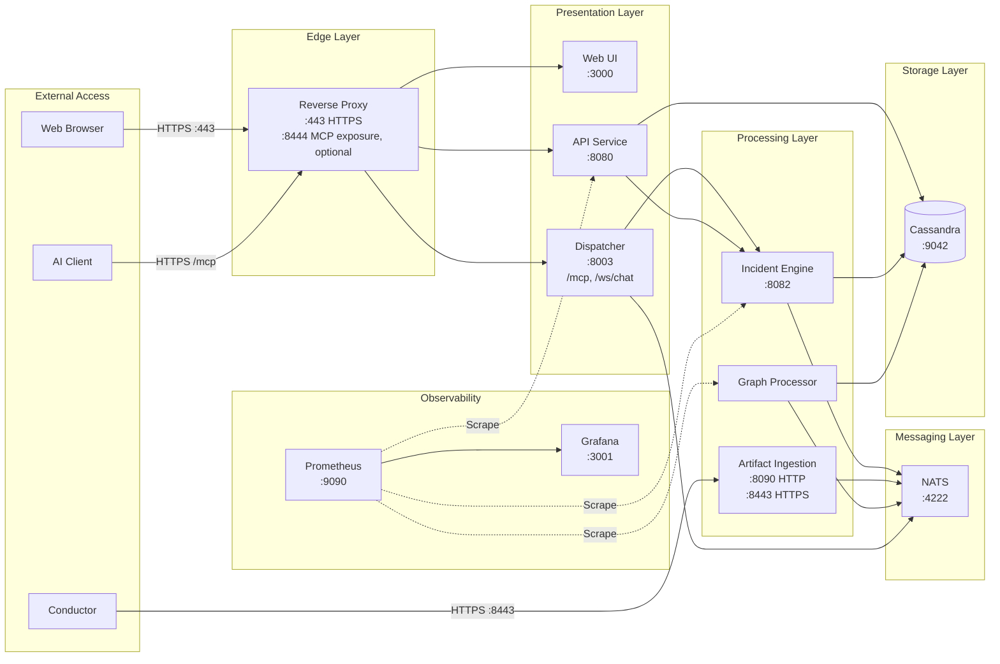
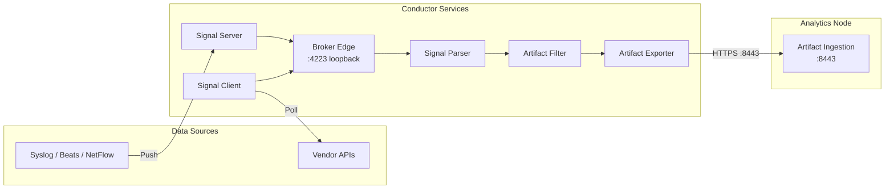
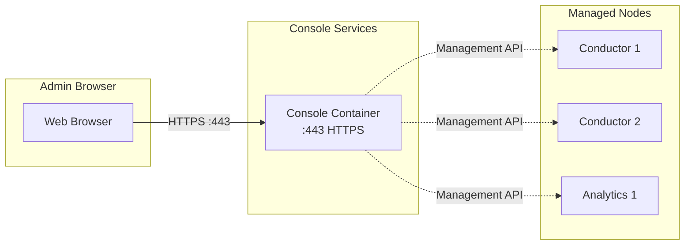
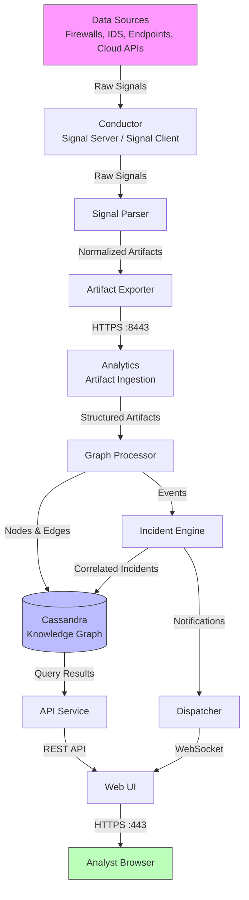

# Architecture

WitFoo Analytics uses a distributed, containerized architecture where each node role runs a specific set of services. This page describes the service architecture, inter-node communication, and data flow.

## Deployment Topology

A complete WitFoo Analytics deployment consists of up to three node roles working together:

## Service Architecture — Analytics Node

The Analytics node is the primary platform, running all services required for investigation, correlation, and reporting.

The reverse proxy sends the WebSockets (`/ws/chat`, `/ws/graph`, `/ws/events`) and the MCP endpoint (`/mcp`) to the dispatcher. An AI client reaches `/mcp` on port 443, or on the optional MCP exposure listener on port 8444. See [MCP](../ai/mcp/index.md).

### Analytics Services

| Service | Port | Description |
|---------|------|-------------|
| Reverse Proxy | 443, 8081 | TLS termination on 443 and plain HTTP on 8081; routes requests to the UI, API and dispatcher |
| Web UI | 3000 | Svelte-based user interface |
| API Service | 8080 | REST API, authentication, RBAC |
| Incident Engine | 8082 | Incident correlation, scoring, status management |
| Graph Processor | — | Builds and maintains the security knowledge graph |
| Artifact Ingestion | 8090, 8443 | Receives artifacts from Conductors: HTTP on 8090, HTTPS on 8443 |
| Dispatcher | 8003 | WebSockets, the MCP endpoint (`/mcp`), and real-time event delivery |
| NATS | 4222 | Internal message bus for service communication |
| Cassandra | 9042 | Primary data store for all analytics data |
| Prometheus | 9090 | Metrics collection (bound to localhost) |
| Grafana | 3001 | Metrics visualization dashboards (bound to localhost) |

## Service Architecture — Conductor Node

The Conductor node handles data ingestion from remote networks and forwards processed signals to the Analytics node.

### Conductor Services

| Service | Port | Description |
|---------|------|-------------|
| Signal Server | 514/tcp, 514/udp, 5044, 5045, 6514, 7514, 2055/udp | Receives raw signals from data sources: syslog, Beats, and NetFlow/IPFIX |
| Signal Client | — | Polls vendor APIs (pull connectors) |
| Broker Edge | 4223 | NATS message broker for the Conductor pipeline |
| Signal Parser | — | Parses and normalizes signals into structured artifacts |
| Artifact Filter | — | Deduplicates and enriches artifacts |
| Artifact Exporter | — | Forwards processed artifacts to the Analytics node and other destinations |
| Conductor UI | 443 | Web management interface on a standalone Conductor (8000 inside the container) |

The NetFlow/IPFIX listener (2055/udp) and the HTTP/8008 Artifact Receiver are off until you enable them under **Log Servers** in the Conductor UI. See [Log Server Configuration](../conductor/ui/log-servers.md).

## Service Architecture — Console Node

The Console node is a lightweight management interface for monitoring and configuring remote Conductor and Analytics nodes.

### Console Services

| Service | Port | Description |
|---------|------|-------------|
| Console | 443 | Single-container management UI and API |

## Data Flow

The following diagram shows how security data flows from ingestion to investigation:

### Data Flow Summary

1. **Ingestion** — Data sources push raw signals (syslog, Beats, NetFlow/IPFIX) to the Conductor's Signal Server, and the Signal Client polls vendor APIs.
2. **Parsing** — The Signal Parser normalizes raw signals into structured artifacts.
3. **Export** — The Artifact Exporter sends normalized artifacts to the Analytics node's Artifact Ingestion receiver over HTTPS (port 8443), each batch signed with an HMAC secret.
4. **Processing** — Artifact Ingestion publishes artifacts to NATS, and the Graph Processor builds a security knowledge graph in Cassandra.
5. **Correlation** — The Incident Engine analyzes graph data to detect, score, and correlate security incidents.
6. **Notification** — The Dispatcher delivers real-time updates to connected web UI sessions via WebSocket.
7. **Investigation** — Analysts access the platform through the web UI (HTTPS on port 443), querying the API for incidents, graph data, and reports. AI clients connect to the MCP endpoint (`/mcp`) through the reverse proxy.

## Network Ports

### WFA Appliance (WFA 2.5.1 and later)

| Port | Protocol | Service | Published on | Description |
|------|----------|---------|--------------|-------------|
| 443 | HTTPS | Reverse Proxy / Console / Conductor UI | All interfaces | Web UI, API and `/mcp` access (the port is set in `wfa configure`) |
| 8081 | HTTP | Reverse Proxy | All interfaces | Plain-HTTP listener of the reverse proxy |
| 8444 | HTTPS | Reverse Proxy (MCP exposure listener) | All IPv4 interfaces | Optional; off unless `mcp_http_enabled` and `mcp_exposure_enabled` are both set |
| 8443 | HTTPS | Artifact Ingestion | All interfaces | Artifacts from Conductors |
| 8090 | HTTP | Artifact Ingestion | All interfaces | Artifacts from the local Conductor on an AIO + Conductor node |
| 9042 | TCP | Cassandra | All interfaces | Database; needed between Processing and Data nodes. Restrict it at the host firewall |
| 4222, 8222 | TCP | NATS (Analytics) | `127.0.0.1` only | Internal message bus and its monitoring port |
| 4223 | TCP | Broker Edge (Conductor) | `127.0.0.1` only | Conductor message broker |
| 9090 | HTTP | Prometheus | `127.0.0.1` only | Metrics |
| 3001 | HTTP | Grafana | `127.0.0.1` only | Dashboards |
| 514 | TCP, UDP | Signal Server | All interfaces | Syslog |
| 6514, 7514 | TCP | Signal Server | All interfaces | Syslog over TLS; syslog RFC 6587 |
| 5044, 5045 | TCP | Signal Server | All interfaces | Beats (5044 with TLS, 5045 without) |
| 2055 | UDP | Signal Server | All interfaces | NetFlow v5/v7/v9 and IPFIX, on Conductor and AIO + Conductor nodes; off until enabled under **Log Servers** |

The api (8080), incident-engine (8082), dispatcher (8003) and UI (3000) ports are not published on the host. Reach them through the reverse proxy.

### Docker Compose

On Docker Compose, `INTERNAL_LISTEN_IP` (default `127.0.0.1`) publishes the internal services: NATS (4222, 8222), the api (8080), incident-engine (8082), the dispatcher (8003), the UI (3000), Prometheus (9090) and Grafana (3001). `LISTEN_IP` publishes Cassandra (9042, 9160), the artifact receiver (8090, 8443) and the edge (443, 8081).

The compose files do not publish 2055/udp. To receive NetFlow on a compose stack, add `2055:2055/udp` to the signal server's ports.

The development compose file `docker/docker-compose.yml` also runs the responder engine: its API (8084) is not published, and its metrics port (9094 by default, 9095 in that compose file) is published on `INTERNAL_LISTEN_IP`.

!!! tip "Minimal Firewall Configuration"
    For a single Analytics node deployment, only port **443** needs to be open to users. Open **8443** to your Conductor nodes, and on a Conductor open the Signal Server ports your data sources use. Open **8444** only if you use the MCP exposure listener, and restrict its sources at your perimeter.
